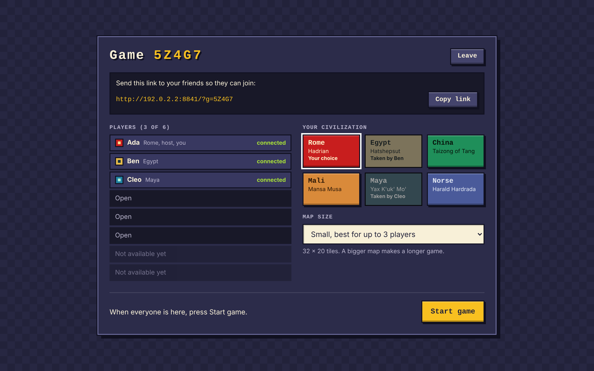
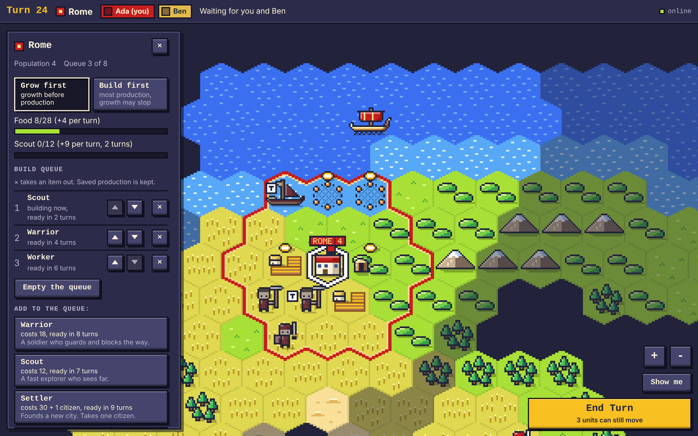
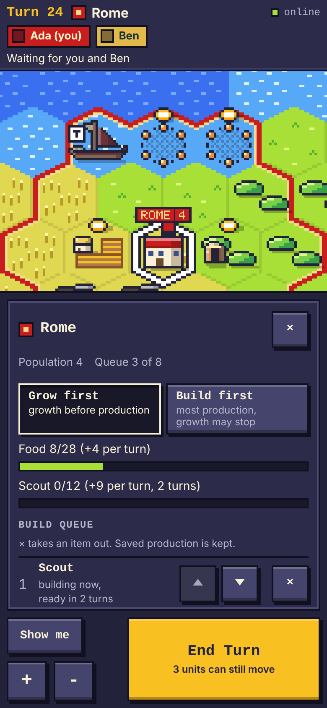
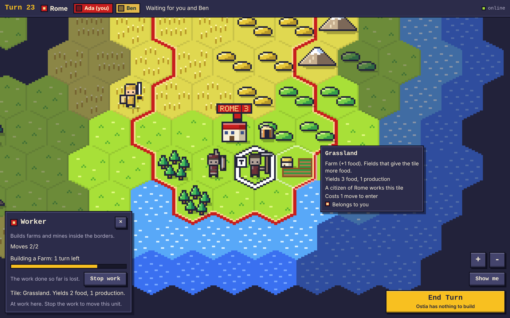
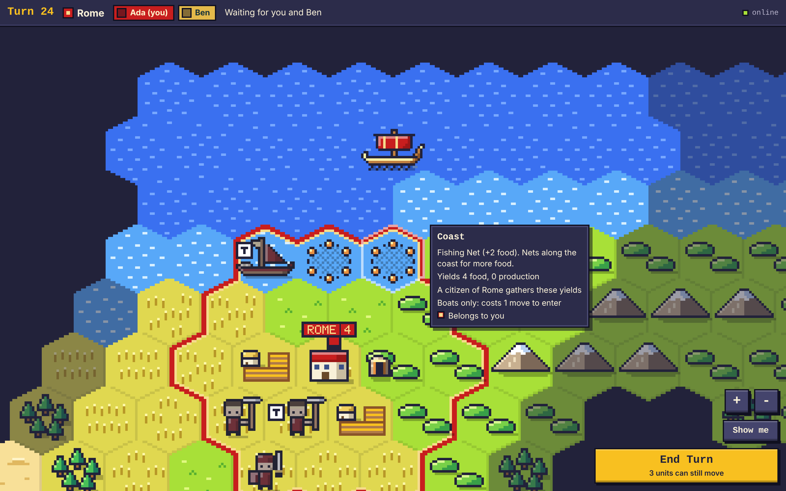

# Domination

An original, multiplayer-first, turn-based strategy game on a hex map: explore, found cities, grow an empire, and play it with friends in a web browser. Everybody takes their turn at the same time, and a game can be played live in an evening or slowly over days.


*Turn 23 of a three-player game, as the Maya player sees it: her cities Copan and Tikal, Rome and Egypt next door, and darker land she has explored but cannot see right now.*

**Where the project stands:** phase 1 is finished and playable. A second round added what the first evenings of play asked for: words about every tile, a build queue for cities, and Workers. A third round added boats (a Fishing Boat that builds fishing nets and a Scout Boat that explores), two buttons for every city, "Grow first" and "Build first", and the sea and a hill at every start of a new game. You can create a private game, invite friends with a link, pick one of six civilizations, and play on a freshly generated map: move Warriors, Scouts, Settlers, Workers and boats, found cities, give each city a queue of things to build, improve your land with farms and mines and your coast with fishing nets, and watch cities grow. Rest the mouse on a tile, or tap it, to read what is there. Everybody sees only what their own units and cities can see (fog of war). Games are saved after every move and survive a closed browser or a restarted server. There is no fighting, research or winning yet: those come in later phases (see "Good to know" at the end). Also not in this round: carrying land units over water, fish and other resources, harbours and other buildings, trade routes and rivers.

## What you need

- [Node.js](https://nodejs.org) version 22.12 or newer (it includes `npm`).
- A terminal opened in this folder.

## Install

```
npm install
```

Do this once, and again whenever `package.json` changes. It downloads the tools the project uses into `node_modules/`.

## Run it to play with friends

```
npm run build
npm start
```

Then open <http://localhost:8787> to try it yourself. One program serves both the web page and the game. Type your name and press "Create private game"; the lobby shows a link for your friends (it ends in `?g=` and a five-character code). When everyone is in the lobby, the player who created the game presses "Start game". Stop the server with `Ctrl+C`; the games are kept (see "Saved games").



*The lobby of a game with three players, opened through the computer's network address, so the link it shows is ready to send.*

- **Before you send the link, open the page through an address your friends can reach.** `localhost` means "this computer" on every computer, so a link that starts with `http://localhost` only works on yours (the lobby warns you when it shows such a link). On the same network, use your computer's address instead, for example `http://192.168.1.20:8787`; on a hosting service, the server's address. The link the lobby shows is built from the address you opened the page with, so opened that way it is ready to send, for example `http://192.168.1.20:8787/?g=K7QXM`.
- Run `npm run build` again whenever the code has changed. `npm start` serves what the last build made. ("Updating the game" below has every step of an update, in order.)
- On a hosting service, install with the plain `npm install` (not `--omit=dev` or "production only"): `npm run build` needs the development tools.
- To play over the internet, put the server behind something that adds HTTPS (for example the Caddy web server). Without it, the secret that identifies each player travels unprotected.
- **Keeping it running on a server.** `npm start` is meant for a terminal that stays open and is stopped with `Ctrl+C`. To keep the server running after the terminal is closed (on Linux or macOS), start the program that `npm start` runs, without npm, from this folder, and let it write into a file what it would have printed:

  ```
  nohup node --import tsx packages/server/src/main.ts > server.log 2>&1 &
  echo $!
  ```

  The second line prints the server's process number, for example `28286`; write it down. `tail server.log` shows the last lines the server has printed, among them its address and how many saved games it loaded. If the number is lost, `pgrep -f packages/server/src/main.ts` prints it again. To stop the server, type `kill` and that number (`kill 28286`). That stops it cleanly: the log ends with "Stopping the server..." and the address no longer answers. Settings go in front as usual (`PORT=9000 nohup node ...`).

  Do not put `npm start` itself into the background: npm runs the server as a program of its own, and stopping npm by its number leaves the real server running. A service manager that stops the whole group of processes is fine too. If the next start says the port is in use (`EADDRINUSE`), an old server is still running.

**How to play, in short.** Tap one of your units to select it; the tiles it can reach light up; tap one to go there. When two of your units share a tile (as at the start), tap the tile again for the other one; the same goes for a city with a unit standing in it (the unit's panel says so). Select your Settler and press "Found City". A new game shows a short "First steps" note until you have founded your first city. Its last sentence, "Where it stands now, a city would own water and a hill.", is there for as long as it is true of the tile your Settler stands on: every new game starts on such a tile, and a city founded somewhere else may get neither ("Boats" below). While a unit is selected, a tap on a highlighted tile sends it there, also when one of your cities or other units is on that tile: close the unit's panel first (the × button, or `Esc`) if you meant to select that instead. One exception: when the map has just stepped aside by itself, as it does when a panel opens over the unit you selected, a tap on a highlighted tile does nothing for half a second, because another tile lies under your finger than a moment before; wait a moment, or tap again. Drag the map to scroll; zoom with the mouse wheel, the + and - buttons, or two fingers on a touch screen. When you are done, press "End Turn"; the next turn starts when every player has. The button says what is still to do (a city with nothing to build first, then how many units can still move), and "Show me" takes you there. Nothing ever stops you from ending the turn. Keys: `Enter` end turn, `N` next unit, `F` found city, `Esc` close the box at the mouse first, then the open panel, arrow keys or `W` `A` `S` `D` scroll, `+` and `-` zoom.

**What a city builds.** Tap a city to see its build queue. The buttons at the bottom of the panel (under "Choose what to build" while the city builds nothing, "Add to the queue" otherwise) put a unit at the end of it (there are six: Warrior, Scout, Settler, Worker, Fishing Boat and Scout Boat); the arrows of a row move that item up or down; the × of a row removes it. The first row is what the city is building now, so removing it stops that build, and what the city has saved goes to the next item (a small line above the rows says that nothing is lost). A finished item leaves the queue. Every row says in how many turns it will be ready ("building now, ready in 5 turns", "ready in 8 turns"): the game plays the city forward for that, growth included. A city with an empty queue builds nothing, and its panel says so in gold: "Nothing to build: production is lost." What it has saved waits for the next item; what it makes meanwhile is lost, turn after turn. Such a city carries a small gold sign on the map (at the upper left of its hall), and the End Turn button names it. A Settler needs a city of two citizens and takes one along; while a Settler is paid for and the city is too small, the panel says "Waiting", and the down arrow lets the next item through. Where the game can name no turn for an item, its add button says why in brackets: "costs 30 (the city must grow first)" for a Settler in a city that is not growing, "costs 30 (more than 50 turns)" behind a long queue.



*Turn 24 of a two-player game, as the Roman player sees it. Under Rome's name are the two buttons; "Grow first" is the chosen one. Rome is building a Scout; a Warrior and a Worker wait behind it, and every row says when it will be done. Three of the six add buttons are in view; the others, the two boats among them, are reached by scrolling the panel. The gold tokens on the map, one at the top of a tile, mark the tiles Rome's citizens gather from: two fishing nets, the farm left of the city and the mine right of it. A token is a small gold ring with a white middle, so that it is not taken for a hill. On the water a Fishing Boat is building a third net (the white sign beside it means "at work"), and a Scout Boat is out at sea.*



*The same city on a phone held upright. The panel sits below the map and scrolls inside itself; its head, with the name, the queue count and the close button, stays in place, and the two buttons stand right under it. Under the panel, "Show me" and the zoom buttons stand left of End Turn.*

**Workers, farms and mines.** Two words that are easy to mix up. **Citizens** are the people of a city: the number beside its name. They are not units, and you do not move them. Each citizen gathers the food and production of one tile of the city's land, and the game places them; the gold tokens show where (a small gold ring with a white middle at the top of a tile, shown while the city is selected). A **Worker** (and at sea a Fishing Boat) is a unit you move; it builds things on tiles and gathers nothing. So a tile can have a Worker building on it and still give its city nothing: the box of the tile then says "No citizen gathers these yields".

A Worker builds farms (more food; on open grassland, plains or desert) and mines (more production; on hills), inside your own borders only. Select it, walk it to a tile, and press "Build Farm" or "Build Mine" in its panel; where a button is greyed out, a line says why. The work takes a few turns and the Worker stays on its tile meanwhile. "Stop work" lets it move again. If turns have been worked, the button asks once ("Tap again to stop") and says how many turns will be lost.

Every start now has a tile for a Mine inside the first city's land, where a Worker can walk to it. That is so for a first city founded where its Settler starts, before another city is founded within four tiles of that spot ("Boats" below says what can happen otherwise). A mined hill is the best tile a city can have, but it gives no food, and on "Grow first" the citizens put growing first: where the city would otherwise stop growing, they give up the tiles with the least food first, and a mine gives none. So a city that can grow leaves its mine until the other tiles its citizens choose bring food enough to spare, now and then also where it could have kept the mine by giving up another tile instead. To be used, a mine needs food from somewhere else: a farm on grassland, or a fishing net. A first city founded on its start has coast, so where the land has no open grassland, fish first. Measured on 1800 first cities of generated maps, each played alone for 150 turns: with a Worker alone the mine was never used in one city in seven; with nets in none. A farm on plains or desert does not help a mine: it feeds the citizen who gathers from it and nobody else. On "Build first" the mine is always in use. A mine has its price: the citizen in it brings no food, so the city grows more slowly. The box of a tile says whether a citizen gathers its yields, and while a city is selected a small gold token at the top of each such tile shows the same on the map, also where a unit stands on the tile.



*The same turn, one zoom step closer. The Worker (selected; the white sign beside it means "at work") has three turns left on a third farm. The box that comes up when the mouse rests on a tile says what is on its tile: the Worker builds there, and no citizen gathers the tile's yields. The Worker's panel says what stopping would cost. Left of Rome is the farm it finished first; the mouth of the mine is in the hill right of Rome. A second Worker stands beside the first.*

**Boats.** Every new game starts by the sea: a city founded where your Settler starts owns at least three coast tiles (the pale water by the land). Two things can undo that. A Settler that walks first may found a city that reaches no water, and such a city can never build boats, because a city's borders do not grow. (Measured on 3,000 starts of generated maps of every size: of the first cities founded one tile from the start, about one in six owned no water, and about one in three no hill for a Mine.) And a city that somebody founds four tiles from your start before you have founded takes the tiles it reaches first; closer than that, you can no longer found on that spot at all. A city with water inside its borders can build two boats. A finished boat appears on a free water tile of its city, the one nearest to the city (on the sea, where the city also owns a lake). Boats sail on coast and ocean, one tile for each move, and never go on land; land units never go on water, and nothing carries a unit across. The **Fishing Boat** is the Worker of the sea. Sail it onto a coast tile inside your borders and press "Build Fishing Net": four turns later that tile gives 4 food instead of 2. The boat stays, and can go on to the next tile. The **Scout Boat** explores: it moves four tiles a turn and sees four tiles far, enough to find the other players along the coast. There is no fighting yet, so it only looks. In a city with no water in its borders the two entries are grey and say "needs water inside this city's borders": found a city whose land reaches the water.



*The same turn with no panel open. At the left a Fishing Boat is building Rome's third net; the white sign beside it means "at work", and a unit that will not move this turn is drawn darker. Right of it are the two nets it finished, with the box that comes up when the mouse rests on one. Above them is the Scout Boat.*

**What a net costs.** A citizen who fishes gathers food and no production. A fished tile is the best food a city has, so citizens go there first: the city grows faster and, for a while, builds more slowly. Measured on 1800 generated first cities with a Worker at work: for about 30 turns after the first net the city built about a sixth more slowly (in nine first cities of ten), and in more than half of them it made less per turn than it had made before the net. From about turn 50 it built faster; by about turn 85 it had made up the loss, and one city in seven had not by turn 150. After 100 turns it had 16 or 17 citizens instead of 10. If a city should build now and grow later, press "Build first".

**Grow first or Build first.** Under a city's name are two buttons. **Grow first** is how every city starts and how cities have behaved so far: its citizens take the best tiles, and take food before production whenever the city would stop growing. **Build first** puts production first: the citizens take the tiles with the most production, and the city grows slowly or not at all (the food line then says "not growing"). Press one and look: the gold tokens on the map move, and the panel shows the new food, the new production and the new "ready in" of everything in the queue. In a very small city the two can come to the same tiles; then only the buttons change. Nothing is lost by pressing; the choice counts when the turn ends. What a turn on "Build first" costs: while the food line shows a minus, the city eats the food it has saved, down to 0. It never loses a citizen.

When to press it: when something must be finished soon. A turn on "Build first" is worth about 6 production and costs about one turn of growth. Press "Grow first" again afterwards: nothing on the map reminds you, only the city's panel and the box of its tile ("Set to Build first: not growing"). A city that has stopped growing on "Grow first" loses nothing on "Build first", but a city that is farmed and fished rarely gets there. A fished and farmed first city that switched after turn 60 had made about a tenth more production by turn 100 than one that stayed on "Grow first", and was three citizens smaller.

When not to: in a young city. Set to "Build first" from its first turn, a first city stayed at one or two citizens in every one of 1800 cities measured, and at one citizen in a quarter of them, where a Settler is never finished; over 150 turns it made a quarter less on bare land, and half as much where a Worker and a Fishing Boat were at work. A city set to "Build first" at turn 11 and forgotten had 4 citizens at turn 100 instead of 16. The citizens take the tiles with production first: in a small city that leaves the nets and most farms unused; in a large one the citizens left over still fish. Other players cannot see which you chose.

**Reading the map.** Rest the mouse on a tile for a moment: a box beside the tile says what is there (the ground, a city, units, a farm, a mine or a fishing net, what the tile yields, what it costs to enter and whose land it is; for your own city what it builds, and "Set to Build first" while it is; and on your own land whether a citizen gathers the tile's yields and what could be built there, with the unit that builds it: "A Worker can build a Farm here", "A Fishing Boat can build a Fishing Net here"). Land says what it costs a land unit to enter; water says "Boats only: costs 1 move to enter". Tap or click a tile that holds nothing of yours, and the same words appear on a card at the bottom left (on a phone held upright: below the map); on a phone, where nothing hovers, that is the way to read a tile. Another player's unit or city is read the same way.

**The news of a turn.** When a turn begins, short messages at the top of the map say what happened to you: a city grew, a unit was completed, a Worker finished a farm, a Fishing Boat a net. Several farms, mines or nets of one kind finished near one city in the same turn are one message with a number ("3 Farms were finished near Rome."). At most five messages are shown. If a turn brings more, the ones that ask for something are kept (a city with nothing left to build), and the last line says how many things happened that are not shown ("And 4 more pieces of news." for three farms and a mine). A message goes away after four seconds, or sooner when the next turn begins: the news of the turn before never stands under the new turn's line. In a laptop-sized window a click on it closes it sooner; on a phone, on any touch screen and in a small window a tap goes through it to the map under it, so that it can never be in the way of a tile. There is no place yet to read the news of a turn again later.

## Run it while developing

```
npm run dev
```

Then open <http://localhost:5173>. This starts the game server and a development web server together; the page reloads by itself when a file changes. Stop it with `Ctrl+C`.

The development server keeps its games in `data-dev/`, not in `data/`, so trying something out never touches the games you host with `npm start`, even on the same computer.

Pages that only exist in this mode, for looking at one thing at a time:

| Address | What it shows |
|---|---|
| <http://localhost:5173/?demo> | The game screen with sample data and no server. `?demo=lobby` shows the lobby, `?demo=home` the first screen. (This one also works on the built game.) |
| <http://localhost:5173/dev-map.html> | Only the map, with sample data: for working on how it is drawn. |
| <http://localhost:5173/sprites.html> | Every picture of the game, enlarged. |
| <http://localhost:5173/src/dev/big-map.html> | A made-up map of the largest size with a read-out of how long a frame takes. |

**Trying several players on one computer.** All tabs of one browser are the same player (the browser remembers who you are). To be a second player, open the page in another tab with `?profile=2` in the address, for example `http://localhost:5173/?profile=2` (then `?profile=3`, and so on). A private window or a second browser works too.

**Two people developing on one machine** give the second setup its own ports and its own folder for saved games: `PORT=8801 DEV_PORT=5201 DOMINATION_DATA_DIR=data-dev-2 npm run dev` (`PORT` is the game server, `DEV_PORT` the development page).

## Test it

| Command | What it does |
|---|---|
| `npm test` | Runs all unit tests (about 1,550; it takes well under a minute). None is skipped. |
| `npm run typecheck` | Checks the whole code base for type mistakes without running it. |
| `npm run e2e` | Runs the end-to-end test (about two and three quarter minutes): two real browsers create a game, join, play a first turn, reload, and come back after the server was restarted. It then checks three things about the screen that once went wrong (what a stranger sees who opens the link of a running game, the city panel in a low window as on a phone held sideways, and the top bar with very long player names) and five small ones: a damaged link, the lobby's warning about a `localhost` link, a double-click on Start or Leave, the Enter key after a click on a zoom button, and the "Turn 3 has begun." message. Then the two play on for the second round: the box at the mouse and the card for a tapped tile (also with a finger, in a phone-sized window), a build queue that is edited and runs empty, and a Worker that is built, walks to a tile and finishes a farm, which is still there after a reload. Last come the presses that once went wrong: a double-click on a unit that stands where its own button comes up, quick clicks and taps on the queue's arrows, its x and its add buttons (in a laptop window, a large one and on two phone sizes), the keyboard, and two quick clicks through a slow connection; a finger that takes two seconds between two taps on one ×, a double tap on a unit at the edge of the map, three presses of Enter in a row, End Turn pressed while an answer is on its way, and two tabs of one browser, which stay one player. And what the panels grey out: with a full queue and after End Turn every button that gives an order is grey, and the sentence that says why is in sight with it, on phone sizes too. On the way it looks at a few things about the map: a tap that goes through the news of a turn on a phone, a selected city that stays on the screen when the phone is turned, the box at the mouse beside an open card, and a card that is left open while the turn ends. Last comes the third round: both first cities own coast and a hill to mine; the city panel has six things to build and the two buttons "Grow first" and "Build first", which are pressed with a mouse and with a finger, on three phone sizes and once through a slow connection, with a look at the gold tokens, the food line and the "ready in" that follow a press; a Fishing Boat is built, appears on the city's water, sails on water only and builds a fishing net; "Stop work" asks once; the card of the fished tile says what it yields, also after a reload; and a Scout Boat sails out to sea. The game is at turn 28 when the test ends. All the way it checks that the other player is shown none of it. It uses its own server and its own throw-away folder for saved games. Needs `npm run build` first, and [Playwright](https://playwright.dev), which `npm install` does not fetch: install it separately and set the `PLAYWRIGHT_PATH` environment variable to its folder. |

## Saved games

The server saves every game to disk after every accepted action, so closing the browser, losing the connection or restarting the server loses nothing.

- Saves live in the `data/` folder next to this file, one file per game: `data/rooms/K7QXM.json`.
- **Back up** by copying the `data/` folder. **Restore** by copying it back while the server is stopped.
- **Never run two servers on the same folder of saved games** (for example `npm start` twice with different ports). Each keeps its games in memory and writes whole files, so each would silently write over what the other saved. Nothing checks this for you. (`npm run dev` has its own folder, `data-dev/`, for this reason.)
- If the disk is full, a move cannot be saved: the player is told "The server had a problem. Please try again.", the server prints "saving failed", and the last complete save stays as it is. Make room and play on.
- A save that cannot be read is moved aside (`.corrupt`), never deleted, and the server still starts. "Getting a game back after a slip" below says how to repair it.
- A save made by a newer version of the game than the one running is left untouched and not loaded; the server says so when it starts. Its players are told "This game is on the server but could not be opened. Ask the person who runs the server.", and their pages keep the game's link. Run the matching version of the code, which is then the newer one, and the game is back: a page that was left open finds its way back by itself, and any other one by opening the game's link again. "Updating the game" below has the steps to get the newest version, and at its end the way to return to it after a step back to an older one.
- A game saved by an older version of the game is converted when the server starts, and the server says so ("Saved games: K7QXM.json was made by an older version of the game (layout 2) and has been brought up to layout 3. The file itself is rewritten with the next change to the game."). In a game that phase 1 saved, every city goes on with the item it was building, once; then its queue is empty and it asks for a new one. In every game saved before the boats, every city is on "Grow first", which is how it behaved before, and the map is the map the game had ("Good to know" says what that means for boats). A game that does not convert cleanly is not loaded and its file is not touched; the server says which ("K7QXM.json was left alone and NOT loaded.") and names up to three things that do not fit. The likeliest reason is a game played with numbers you had changed (a Scout with more moves than the table of the new version allows, say): the update has put the old numbers back. As the server's sentence ends: "If you changed numbers in packages/shared/src/data, make the same change again and restart. The file has not been touched." The server keeps no copy of the older file, so **copy the `data/` folder before you update**: "Updating the game" below has the steps in order, and the way back.
- A game that was created but never started (its creator closed the page without pressing Leave) stays in the folder as a small file. Deleting such a file while the server is stopped is safe.

**A player lost their seat** (new phone, cleared browser data, another browser): the game cannot tell them apart from a stranger, and a running game waits for that seat every turn. The person who runs the server can free the seat:

1. Stop the server.
2. Open the game's file, for example `data/rooms/K7QXM.json`, in a text editor. Near the top, under `"seats"`, every player has one line. Find the player's line (by `"name"`) and change its `"tokenHash": "..."` to `"tokenHash": null`. Change nothing else: a seat's line cannot be deleted, and its `"playerId"` must stay as it is (the server would set such a file aside at the next start and say why; "Getting a game back after a slip" below is the way out).
3. Start the server. The player opens the game's link, types a name and presses Join: they are back on their old seat, with its old name.

Two things to know about a freed seat:

- **It goes to the first browser without a seat in this game that opens the link and presses Join.** That need not be a stranger: it can be another player of the same game on a second device or in another browser, who would then see and play that side. So free the seat when the returning player is ready to press Join at once (stay on a call with them), and ask them to confirm that they are in. The server prints a line when the seat is taken. If the wrong person got it, do the three steps again.
- **Free one seat at a time.** If two players lost their seats, do the steps for one, wait until that player is back, then for the other. Two free seats are handed out in the order people join, whatever names they type, so two players could end up on each other's side.

**Getting a game back after a slip.** If a mistake crept in while a saved game was edited by hand (a comma or a quotation mark lost, a `"playerId"` changed), the server cannot use the file at its next start. It does not delete it: it gives the file a new name that ends in `.corrupt`, starts without that game, and says why, for example:

```
Saved games: K7QXM.json is damaged (it cannot be read (Expected ',' or '}' after property value in JSON at position 311 (line 9 column 43))). It was moved aside as .../data/rooms/K7QXM.json.corrupt and not loaded.
```

Nothing is lost, and the game comes back like this:

1. Stop the server.
2. Open `data/rooms/K7QXM.json.corrupt` in a text editor and correct the slip. The server's sentence says what is wrong, and for a lost comma or quotation mark in which line.
3. Give the file its old name back: rename `K7QXM.json.corrupt` to `K7QXM.json`.
4. Start the server. It now counts the game among the "Saved games loaded", and the players are back in it where they left off.

If the server sets the file aside again, its new sentence names the next slip; do the four steps once more. (A file that is set aside while an older `.corrupt` file of the same game is still lying there gets the ending `.corrupt.2`; the newest one is the one to repair.)

## Updating the game

When there is a new version of the code, do these steps in this order, in this folder. Players can leave their pages open.

1. **Stop the server** (`Ctrl+C`, or `kill` and its number).
2. **Copy the `data/` folder**, for example with `cp -r data data-before-update` (Linux or macOS). The new version brings saved games up to its own layout and keeps no copy of the old files, so this copy is your only way back. (From this version on, git keeps every folder here whose name starts with `data-` out of the repository, as it does `data/`, so such a copy is never uploaded by mistake. On an older version, reached by the way back below, `git status` lists these copies as "untracked"; that does no harm as long as you do not add them with `git add`.)
3. **Get the new code.** With git: `git pull`. If git answers "Your local changes to the following files would be overwritten by merge" and names files in `packages/shared/src/data`, you had changed numbers of the game: write your changes down, put the tables back as they came with `git checkout -- packages/shared/src/data`, and run `git pull` again.
4. **If you had changed numbers** in `packages/shared/src/data`, make the same changes again now, before the first start. A running game that was played with other numbers than the server has now can be refused (see "Saved games": "was left alone and NOT loaded"). Nothing is lost by that: make the change and start again.
5. `npm install`
6. `npm run build`
7. `npm start`, and read what it prints: "Saved games loaded: 3." (your number of games). Not every update changes the layout of saved games, and when one does not, that is all the server says about them. When an update has changed the layout, there is one more line for every game, above that one: "Saved games: K7QXM.json was made by an older version of the game (layout 2) and has been brought up to layout 3. The file itself is rewritten with the next change to the game." The update to the version with boats is such an update: saved games get layout 3, and page and server speak a new version of their language (protocol 5). A version from before the boats cannot read a game that was played on this one, so the copy from step 2 is the way back.

Pages that players left open reload themselves once and are back in their game a few seconds later. (Tried for this version with a page of the version before, in one browser on one computer: it reloaded once and was back in its game two and a half seconds after the new server had started.) The server prints one line when such a page says hello for the last time: "A page of an older version connected (it speaks protocol 4, this server protocol 5) and was told to reload. ..." During an update that line is expected.

**If everybody sees "This page and the game server are not the same version"**, also after reloading, the build was forgotten (step 6): the server is the new one, and the page it hands out is still the old one. The server's line "A page of an older version connected ..." says the same at its end. Stop the server, run `npm run build`, start it again, and let the players press Reload.

**The way back to an older version**, if the new one does not work for you:

1. Stop the server.
2. `git branch --show-current` prints the name of the line of versions you are on, for example `main`. **Write it down**: it is your way back to the newest version. (If it prints nothing, you are on an older version already. `git branch` then lists the name: it is the line without a star in front.)
3. `git log --oneline -- .` lists the versions, newest first. Each line starts with the short name of a version, for example:

   ```
   c9362b6 Last small repair of the Domination round 2 review
   6bc093c Add tile information, the city build queue and the Worker to Domination
   ee70e85 Fix the findings of the Domination phase 1 review
   ```

   (The real list is longer, and the version you are on stands at its top. `c9362b6` is the last version before the boats.)

4. `git checkout ee70e85` (with the short name of the version you want) brings that version's code back. Git prints a long note about a "detached HEAD"; that is expected here and nothing to worry about. If git answers "Your local changes to the following files would be overwritten by checkout" instead and names files in `packages/shared/src/data`, it is the numbers you had changed, as in step 3 of the update, and the way out is the same: write your changes down, put the tables back as they came with `git checkout -- packages/shared/src/data`, and run the `git checkout` again. Then make your changes again in the older version, before the first start (step 4 of the update says why).
5. **Swap the saved games.** Where the layout of saved games changed between the two versions (as it did after phase 1, and again with the boats), the older version cannot read what the newer one has saved: it leaves such a game alone and says "Run the matching version to play it." So every version keeps its own saved games: in `data` while you run it, and in a folder that carries its name while you are away from it. That takes two commands, in this order:

   - **The saves of the version you have just left go aside, under its name.** Coming from the newest version: `mv data data-of-the-new-version`. Coming from another older version, because you are trying a second one: `mv data data-of-` and that version's short name, for example `mv data data-of-6bc093c`. (Git has just told you that name, in its line "Previous HEAD position was 6bc093c ...".)
   - **The saves for the version you are on now come in.** The first time you are on it: `cp -r data-before-update data`, the copy from step 2 of the update. If you have been on it before, its own folder is waiting, and you move that back instead: `mv data-of-ee70e85 data` (with its short name).

   Before each of the two commands, type `ls` and look at the list: the name the command moves or copies TO must not be in it yet. If it is, do not run the command as it stands: it would put the folder INSIDE the one that is already there, where the server does not look for games. Use a name that is free instead, for example with `-2` at its end. What was played after the update is not in the copy from step 2; it stays in `data-of-the-new-version`.
6. `npm install`, `npm run build`, `npm start`.

To return to the newest version: stop the server, then `git checkout` and the name you wrote down in step 2, for example `git checkout main`. That works from every older version, also after you have tried several, one after the other. (`git checkout -`, "where I was before", goes back one step only: after two older versions it lands on the first of them, not on the newest.) If git refuses with "Your local changes to the following files would be overwritten by checkout", the way out is the one of step 4, and your changed numbers are made again afterwards. Put the newer saves back if you want to go on with them, by the two commands of step 5: `mv data data-of-` and the short name of the older version you have just left, for example `mv data data-of-ee70e85` (git has printed it again: "Previous HEAD position was ee70e85 ..."), then `mv data-of-the-new-version data`. And again `npm install`, `npm run build`, `npm start`.

## Settings

Settings are environment variables, given when starting the server, for example `PORT=9000 npm start`.

| Variable | Meaning | Default |
|---|---|---|
| `PORT` | Port of the web page and the game | `8787` |
| `HOST` | Network interface to listen on | all |
| `DOMINATION_DATA_DIR` | Folder for saved games. Never the same folder for two servers | `data/` in this folder (`data-dev/` with `npm run dev`) |
| `DOMINATION_CLIENT_DIR` | Folder of the built web page. It must not contain the folder for saved games | `packages/client/dist/` in this folder |
| `DOMINATION_FULL_SYNC` | Set to `1` to send whole views instead of small updates (a safety switch) | off |
| `DOMINATION_SEED` | Same map every time; **for tests only**. Never set it on a real server: every game would have the same map, and whoever has played once knows it all | random |
| `DEV_PORT` | Only for `npm run dev`: port of the development page | `5173` |

## Where things live

```
domination/
  README.md            this file
  ARCHITECTURE.md      how the project is designed, and which file does what
  package.json         the list of tools and the commands above
  docs/art/            the approved art style (reference picture)
  docs/screenshots/    pictures of the game for this file
  scripts/dev.mjs      what "npm run dev" runs (devEnv.mjs next to it: where it keeps its saved games)
  e2e/                 the end-to-end test
  packages/
    shared/            THE RULES OF THE GAME. Used by both server and client.
      src/data/          every number of the game: terrain, units, improvements, civilizations, balance, the two city buttons
      src/hex.ts         hex-grid maths
      src/rng.ts         seeded random numbers
      src/mapgen/        map generation (tuning.ts: the numbers that shape the maps)
      src/rules/         moving on land and water, cities and their build queues, the jobs of Workers and Fishing Boats, turns
      src/view/          fog of war: what each player is allowed to see
      src/protocol.ts    the messages between browser and server
      src/stateMigrations.ts   brings a game saved by an older version up to date
      test/              the tests of all of the above
    server/            the game server (keeps the truth, saves games)
    client/            the web page (map drawing, panels, input)
      src/sprites/art/   the pictures, drawn as text
      dist/              the built page (made by "npm run build"; not in git)
  data/                saved games (created by the server; not in git)
  data-dev/            saved games of "npm run dev" (created by it; not in git)
  data-.../            your own copies of saved games, whatever follows "data-" (see "Updating the game"; not in git)
```

**Changing the game's numbers:** movement costs, yields, unit costs, city rules, map sizes, colours and city names are plain tables in `packages/shared/src/data/`. So are what a farm, a mine and a fishing net give and how long they take (`improvements.ts`), the words on a city's two buttons "Grow first" and "Build first" (`cityFocus.ts`), how long a build queue may be (`rules.ts`; never make it shorter while games are running), how far ahead a city's forecast looks, and the one-line descriptions of units and improvements (at most 42 characters, which a test holds). The 42 are a rule of thumb, not a promise of one line, because characters are not pixels: today's descriptions each stand on one line under their button in the city panel with room to spare, also where the browser shows a scroll bar; a new one with wider letters, or any of them in a wider font than the one the game was built with, does not fit its line and is then cut short with "..." (a line of an add button never takes a second line, so that no button changes its height; resting the mouse on the button shows all its words). The end-to-end test looks at the units' lines themselves. Edit a number, run `npm test`, run `npm run build`, restart the server, and ask players to reload the page: the page works out the highlighted tiles with its own copy of the numbers, and a page built before the change would highlight by the old ones. (With `npm run dev` neither the build nor the restart is needed.) Running games use the new numbers too. Some tests guard how the numbers hang together, and their messages say what does not fit. Many more are simply written for today's numbers (a Warrior that walks two tiles of grassland, say): after a deliberate change such a test fails although nothing is wrong, and its expectation is what has to change.

**Changing what maps look like:** the share of land, the size of mountain ranges, forests and deserts, and how start positions are chosen are numbers in `packages/shared/src/mapgen/tuning.ts`. A city founded on a start, before any other city stands within four tiles of it, owns at least three coast tiles of the sea (the largest body of water of the map) and a tile for a Mine that a Worker can walk to; the three is `MAPGEN.startCoastTiles` in that file. That number can be raised to 6 and no further. With every number from 1 to 6 each map size gave a map for 1 to 8 players (200 tries each, 4,800 maps for each number), though with 6 a small map for eight players took ten attempts on average, and one of 5,000 took 82 of the 100 the map maker has. (A game seats six players today; for six, a small map took two or three attempts on average with the number at 6, and twelve at most.) As with every changed number, tests written for today's 3 turn red when it is changed (14 of them with 5); that is expected. From 7 on, many new games cannot start (with 7, on a small map, 26 of 200 for three players and all 200 for eight): "Start game" then answers "The server had a problem. Please try again.", and the line the server prints names the file and the number. These numbers only affect games started afterwards: a running game keeps its map.

## Good to know (the limits for now)

- **No fighting yet.** Units of different players cannot attack or pass through each other; they simply block the way. Combat, research, buildings and a way to win come in later phases.
- **After updating to the version with boats.** Running games go on. Every city of a running game is on "Grow first", which is how it behaved before. Its map is the map it had: a first city that owns no water shows the two boats in grey, and a start without hills keeps none. To build boats in such a game, found a city whose land reaches the water. (Tried with a game the version before had saved, four players at turn 41: of its six cities one owns no water; another was set to "Build first", built a Fishing Boat in two turns, and had its first net four turns after the boat began it.) New games give every player the sea and a hill in the land of a first city founded where the Settler starts.
- **Every first city is by the sea, if it is founded where its Settler starts.** A first city founded elsewhere may reach no water and then never builds boats ("Boats" above has the numbers). About a quarter of the land of a first city on its start is water, so the starting land scores a little lower than before by the map maker's own count (48 against 50 on average), for every player alike. The starts are as even as before by that score; once everybody fishes, a start with much coast grows larger and builds less than one with little, and the gap in production between the players of one game is wider than it was (in games that are not crowded the weakest makes about 77 % of the strongest over 150 turns, 86 % without boats).
- **Boats in the way.** A boat that stays in a narrow strait, or on the last free water tile of a city, or on a coast tile somebody wants to fish, closes it to others, and nothing can drive it off until the game has fighting. A city whose water tiles are all taken waits with its boat ("no free water tile for the boat"). How much that can be: two first cities in three of a two-player game own exactly three water tiles. Three boats of another player parked there stop that city from building boats for as long as they stay, and each one keeps a net from being built.
- **"Ready in" for a boat** does not count the boats that will be finished before it. A boat waits only when every water tile of its city already holds a boat of the same kind or a boat of another player (a Fishing Boat and a Scout Boat of yours can share a tile). A first city on its start owns three water tiles or more, so the "ready in" of its second and third boat of one kind comes true even if none has moved; in a city with exactly three water tiles a fourth of that kind waits until one sails off.
- **Lakes.** A boat built on a lake cannot leave it. A city that owns water of the sea and of a lake puts its boats on the sea.
- **The city panel is longer.** Six things to build and the two buttons make its content about 200 pixels longer than before (207 with something in the queue, 172 with an empty queue). On a laptop (1280 by 800) with three items in the queue, three of the six add buttons are in view (all four before); on a phone held upright with an empty queue one (two before); on a small phone the heading of the list and the top edge of its first button. On a tablet held upright a queue of five no longer fits without scrolling. Everything is reached by scrolling the panel. A new layout for the panel comes with the next phase.
- **Up to 6 players** for now: civilizations are unique per game and there are six. The game is laid out for 8.
- **Map sizes show a recommended number of players.** More players than that can start, but their starting land is less evenly matched and they begin closer together: now and then a tile closer than the usual eight, because nobody is put alone on a small island while the larger land has room. On a rare map one or two players start on a second landmass, which land units cannot leave.
- **Everybody is waited for.** A turn ends when every player has pressed End Turn; an absent player holds the game up. Turn timers come in a later phase.
- **Check the lobby before you start.** Every seat in the lobby becomes a player, also one whose owner has closed the page ("not connected"), and the game then waits for that seat every turn. The host is warned before starting. A seat can only be given up by its own player (the Leave button); if a seat is stuck in the lobby, make a new game.
- **Only the host can start.** If the host presses Leave, the next player who is connected becomes host. If the host only closes the page, they stay host, and the lobby waits for them to come back.
- **Opening an invite link does not join.** It shows the game's code with a Join button; only pressing Join takes a seat. Coming back to a game you are already in needs no button. If the game has already started, is full or does not exist, the page says so under the code and offers to start a new game instead. A link that was damaged on its way (cut short, or with a full stop stuck to its end) is called damaged; the code can then be typed by hand.
- **A running game has no Leave button.** To get back to the first screen, open the page without the `?g=...` part of the address. Your seat in the game is kept.
- **Your seat lives in your browser.** There are no accounts: the browser remembers a secret that identifies you. Clearing the browser's site data, or switching to another browser or device, loses the seat (see "A player lost their seat" above for the rescue). All tabs of one browser are the same player, also when several are opened at once on the very first visit: the page makes the secret itself and stores it before it talks to the server, so a second tab finds it. (This used to be a gap: two tabs opened in quick succession on a first visit became two players, and one of them lost its seat on reload. After the cure it did not happen once in 90 tries, where it had happened in 20 of 23 before; tried with Chromium only.) What is left is a browser that stores nothing, as some private windows do: there every tab is a player of its own, and the page says "This browser is not saving data" when it opens.
- **On a slow connection.** Nothing on the screen changes at a press: it changes when the server has answered. Quick presses still count. Two taps on an add button are two items, and End Turn pressed right after another button waits for that button's answer and then ends the turn (press it once more while it waits, and it is taken back). Only the arrows and the × of a queue row take one press at a time: on a connection that needs more than about half a second there and back, an entry cannot be walked up the queue faster than the connection answers.
- **Meant for friends, not for strangers.** Anybody who can open the page can create games, and there is no limit on how many. Share the address only with people you trust, or keep the server on your home network.
- **Built and tested in one browser only.** The end-to-end test plays in Chromium (the engine of Chrome and Edge) in a laptop-sized window and, for part of its steps, in phone-sized touch windows. The things of the second and the third round were also played through by a program that drives the same browser the way a person would: a mouse that travels in small steps and is never quite still, the many small wheel events a trackpad sends, and a finger in a phone-sized window, upright and on its side. For the third round that meant: the boats, the two city buttons and "Stop work" at three laptop sizes with a mouse and at three phone sizes with a finger, a game saved by the version before, and a page of the version before left open during the update. What the builders could not try, in any round: a real mouse, a real laptop trackpad, a real phone or tablet, a laptop with a touch screen (it should get the same larger buttons as a phone), Firefox and Safari. Three things to look out for when you play. The box at the mouse comes after 0.4 seconds of rest on a tile; if that feels too slow or too quick, the two numbers are at the top of `packages/client/src/input/hoverInfo.ts`. On a trackpad a gentle two-finger scroll zooms one step, but a quick flick ran through four steps in the trial; the + and - buttons and keys always move exactly one step. And the heads of the panels, which stay in place while a panel scrolls, rest on a style rule that was only seen in Chromium: if a head scrolls away in another browser, nothing else breaks. A fourth thing came with the boats and was put right after their review. Every add button of the city panel has three lines, and each of them is one line in every font, so no button changes its height when an answer comes and the buttons under it stay where they are. The line that says the most, a Settler's "costs 30 + 1 citizen, ready in 48 turns", leaves 17 % of the narrowest panel's line free in the font this was built with (Inter) and 11 % in a wider one that was tried (DejaVu Sans); the longest of all, a boat's "costs 20 (no free water tile for the boat)", leaves 12 % and 7 %. Should your computer's font be wider still, a line that does not fit ends in "..." instead of taking a second line, and resting the mouse on the button shows all its words. A phone has no mouse, but from 360 pixels of width its panel gives a line more room than a laptop's does, and on a phone 320 pixels wide every line still fits in the font this was built with.
- **Small windows.** The game is laid out for a laptop screen and for a phone held upright, where the panels sit below the map. A phone on its side works too, but it is cramped: the panels (a unit's, a city's and the card of a tapped tile) float over the map and scroll inside themselves. There the tile card is at most 150 pixels tall and the unit panel at most 220, and a unit's description is left out, so that a Worker's buttons are in view without scrolling, also after End Turn, when they are grey under the sentence that says why. (That holds on a phone whose short side has 360 pixels or more. On a smaller one, 320 by 568, the lowest button can end under the panel's edge, and the panel has to be scrolled.) When a panel would cover the unit, city or tile it is about, the map steps aside by itself, upwards or sideways; and when the window gets narrower (a phone that is turned), the map brings the selected unit or city back onto the screen. For half a second after the map has moved by itself, a tap on a highlighted tile sends no unit there: another tile lies under the finger than a moment before (a double tap on a unit at the edge of the map used to send it to the tile beside it). On a phone the full words about a tile that holds your own unit or city are not within reach (the unit panel has a one-line summary of its tile); and to read about a highlighted tile while a unit is selected, close the unit's panel first.
- **A city's name plate lies on the two tiles above the city.** At every zoom it covers their lower third: the feet of a Worker there, the lower rows of a farm, most of the mouth of a mine, the hull of a boat (its sail stands above the plate). A new boat prefers the other water tiles of its city; where a first city's only near water lies above it, which is about one first city in eight, its first boat appears there. The box of the tile says what is there. Lower, on the roof, the plate would leave those tiles in view and hide the city's flag instead; that was tried and not taken, and it is one number to change (`BANNER_BOTTOM` in `packages/client/src/render/frame.ts`, 2 to 7).
- **After updating from phase 1.** A running game goes on (see "Updating the game" and "Saved games"). Its cities finish what they were building and then ask for a queue. Since the second round citizens put growing first: a city that used to stand still grows, and builds more slowly while it does. Since the third round that is one of two choices: a city on "Build first" puts production first instead ("Grow first or Build first" above).
- **An idle city loses its production; a waiting city does not.** A city with an empty queue loses what it would have produced that turn. A city whose first item is paid for and cannot be finished yet (a Settler in a city of one citizen) keeps saving. Both are the rule for now; each is one line to change if evenings of play show that queues run out unnoticed.
- **Moving this folder is fine.** Nothing inside refers to where the folder is; move or rename it, then run `npm install` again if the tools complain.
