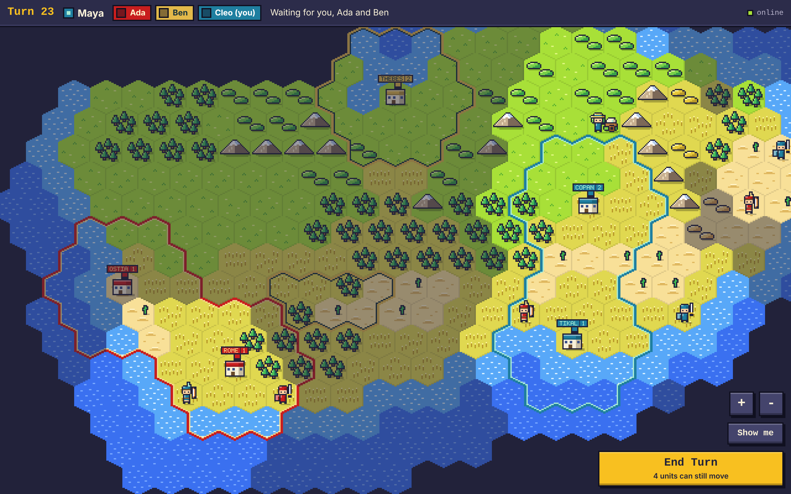

# Domination

An original, multiplayer-first, turn-based strategy game on a hex map: explore, found cities, grow an empire, and play it with friends in a web browser. Everybody takes their turn at the same time, and a game can be played live in an evening or slowly over days.



*Turn 23 of a three-player game, as the Maya player sees it: her cities Copan and Tikal, Rome and Egypt next door, and darker land she has explored but cannot see right now.*

**Where the project stands:** phase 1 is finished and playable, and a second round has added what the first evenings of play asked for: words about every tile, a build queue for cities, and Workers. You can create a private game, invite friends with a link, pick one of six civilizations, and play on a freshly generated map: move Warriors, Scouts, Settlers and Workers, found cities, give each city a queue of things to build, improve your land with farms and mines, and watch cities grow. Rest the mouse on a tile, or tap it, to read what is there. Everybody sees only what their own units and cities can see (fog of war). Games are saved after every move and survive a closed browser or a restarted server. There is no fighting, research or winning yet: those come in later phases (see "Good to know" at the end).

## What you need

- [Node.js](https://nodejs.org) version 22.12 or newer (it includes `npm`).
- A terminal opened in this folder.

## Install

```
npm install
```

Do this once, and again whenever `package.json` changes. It downloads the tools the project uses into `node_modules/`.

## Run it to play with friends

```
npm run build
npm start
```

Then open <http://localhost:8787> to try it yourself. One program serves both the web page and the game. Type your name and press "Create private game"; the lobby shows a link for your friends (it ends in `?g=` and a five-character code). When everyone is in the lobby, the player who created the game presses "Start game". Stop the server with `Ctrl+C`; the games are kept (see "Saved games").


*The lobby of a game with three players, opened through the computer's network address, so the link it shows is ready to send.*

- **Before you send the link, open the page through an address your friends can reach.** `localhost` means "this computer" on every computer, so a link that starts with `http://localhost` only works on yours (the lobby warns you when it shows such a link). On the same network, use your computer's address instead, for example `http://192.168.1.20:8787`; on a hosting service, the server's address. The link the lobby shows is built from the address you opened the page with, so opened that way it is ready to send, for example `http://192.168.1.20:8787/?g=K7QXM`.
- Run `npm run build` again whenever the code has changed. `npm start` serves what the last build made. ("Updating the game" below has every step of an update, in order.)
- On a hosting service, install with the plain `npm install` (not `--omit=dev` or "production only"): `npm run build` needs the development tools.
- To play over the internet, put the server behind something that adds HTTPS (for example the Caddy web server). Without it, the secret that identifies each player travels unprotected.
- **Keeping it running on a server.** `npm start` is meant for a terminal that stays open and is stopped with `Ctrl+C`. To keep the server running after the terminal is closed (on Linux or macOS), start the program that `npm start` runs, without npm, from this folder, and let it write into a file what it would have printed:

  ```
  nohup node --import tsx packages/server/src/main.ts > server.log 2>&1 &
  echo $!
  ```

  The second line prints the server's process number, for example `28286`; write it down. `tail server.log` shows the last lines the server has printed, among them its address and how many saved games it loaded. If the number is lost, `pgrep -f packages/server/src/main.ts` prints it again. To stop the server, type `kill` and that number (`kill 28286`). That stops it cleanly: the log ends with "Stopping the server..." and the address no longer answers. Settings go in front as usual (`PORT=9000 nohup node ...`).

  Do not put `npm start` itself into the background: npm runs the server as a program of its own, and stopping npm by its number leaves the real server running. A service manager that stops the whole group of processes is fine too. If the next start says the port is in use (`EADDRINUSE`), an old server is still running.

**How to play, in short.** Tap one of your units to select it; the tiles it can reach light up; tap one to go there. When two of your units share a tile (as at the start), tap the tile again for the other one; the same goes for a city with a unit standing in it (the unit's panel says so). Select your Settler and press "Found City". A new game shows a short "First steps" note until you have founded your first city. While a unit is selected, a tap on a highlighted tile sends it there, also when one of your cities or other units is on that tile: close the unit's panel first (the × button, or `Esc`) if you meant to select that instead. One exception: when the map has just stepped aside by itself, as it does when a panel opens over the unit you selected, a tap on a highlighted tile does nothing for half a second, because another tile lies under your finger than a moment before; wait a moment, or tap again. Drag the map to scroll; zoom with the mouse wheel, the + and - buttons, or two fingers on a touch screen. When you are done, press "End Turn"; the next turn starts when every player has. The button says what is still to do (a city with nothing to build first, then how many units can still move), and "Show me" takes you there. Nothing ever stops you from ending the turn. Keys: `Enter` end turn, `N` next unit, `F` found city, `Esc` close the box at the mouse first, then the open panel, arrow keys or `W` `A` `S` `D` scroll, `+` and `-` zoom.

**What a city builds.** Tap a city to see its build queue. The buttons at the bottom of the panel (under "Choose what to build" while the city builds nothing, "Add to the queue" otherwise) put a unit at the end of it; the arrows of a row move that item up or down; the × of a row removes it. The first row is what the city is building now, so removing it stops that build, and what the city has saved goes to the next item (a small line above the rows says that nothing is lost). A finished item leaves the queue. Every row says in how many turns it will be ready ("building now, ready in 5 turns", "ready in 8 turns"): the game plays the city forward for that, growth included. A city with an empty queue builds nothing: what it has saved waits for the next item, and what it makes meanwhile is lost every turn. Such a city carries a small gold sign on the map (at the upper left of its hall), and the End Turn button names it. A Settler needs a city of two citizens and takes one along; while a Settler is paid for and the city is too small, the panel says "Waiting", and the down arrow lets the next item through.


*Turn 23 of a two-player game, as the Roman player sees it. Rome is building a Warrior; a Worker and a Scout wait behind it, and every row says when it will be done. Ostia, the new city at the top, has nothing to build yet: the gold sign at the upper left of its hall says so, and so does the End Turn button. The gold tokens on the map, one at the top of a tile, mark the tiles Rome's citizens work: the farm, the mine and a tile of grassland.*


*The same city on a phone held upright. The panel sits below the map and scrolls inside itself; its head, with the name, the queue count and the close button, stays in place. Under it, "Show me" and the zoom buttons stand left of End Turn.*

**Workers, farms and mines.** A Worker builds farms (more food; on open grassland, plains or desert) and mines (more production; on hills), on your own land only. Select it, walk it to a tile, and press "Build Farm" or "Build Mine" in its panel; where a button is greyed out, a line says why. The work takes a few turns and the Worker stays on its tile meanwhile; "Stop work" lets it move again, and the work done so far is lost. Your citizens choose the tiles they work by themselves, the best ones first, and a mined hill is the best tile a city can have. But they put growing first, and a mine gives no food: a city works its mine as soon as it can do so and still grow. For that the mine needs the food of a farm on grassland, so build that farm first, then the mine. With one such farm the mine is worked from the second citizen on; later the citizens leave it only for as long as the city could not grow otherwise (with that one farm alone such stretches were long in about a quarter of the capitals measured: 49 turns of the first 150 on average), and it stays in use when the Worker goes on building farms. A farm on plains or desert does not help a mine: it feeds the citizen who works it and nobody else. Without a farm a mine stands unused for as long as the city can still grow, and growing alone does not bring it into use: only when a city has grown as large as its land can feed do its citizens go back to the tiles that give the most, the mine among them. A mine has its price: the citizen in it brings no food, so the city grows more slowly, and a smaller city makes less of everything later on. Measured on 121 capitals of generated maps, each against the same capital without the mine: built at turn 11, a mine brought 19 % more production over the first 100 turns with one farm (880 instead of 742, and the sixth citizen came 49 turns later) and 8 % more with a Worker that went on building farms, but 4 % less where every open tile was farmed. So a mine pays early (11 to 32 % more production in the first 50 turns); a city that farms all its land and is meant to grow large is better off without one, or with the mine built late: built at turn 60 it brought 9 % more over 150 turns, built at turn 11 3 % less. The box of a tile says whether a citizen works it, and while a city is selected a small gold token at the top of each tile it works shows the same on the map, also where a unit stands on the tile.


*The same turn, one zoom step closer. The Worker (selected; the white sign beside it means "at work") has one turn left on a second farm. Right of it is the farm it finished earlier, with the box that comes up when the mouse rests on a tile; the mouth of the mine is in the hill next to Rome.*

**Reading the map.** Rest the mouse on a tile for a moment: a box beside the tile says what is there (the ground, a city, units, a farm or a mine, what the tile yields, what it costs to enter and whose land it is; for your own city what it builds, and on your own land whether a citizen works the tile and what a Worker could build there). Tap or click a tile that holds nothing of yours, and the same words appear on a card at the bottom left (on a phone held upright: below the map); on a phone, where nothing hovers, that is the way to read a tile. Another player's unit or city is read the same way.

**The news of a turn.** When a turn begins, short messages at the top of the map say what happened to you: a city grew, a unit was completed, a Worker finished a farm. Several farms or mines finished near one city in the same turn are one message with a number ("3 Farms were finished near Rome."). At most five messages are shown. If a turn brings more, the ones that ask for something are kept (a city with nothing left to build), and the last line says how many things happened that are not shown ("And 4 more pieces of news." for three farms and a mine). A message goes away after four seconds, or sooner when the next turn begins: the news of the turn before never stands under the new turn's line. In a laptop-sized window a click on it closes it sooner; on a phone, on any touch screen and in a small window a tap goes through it to the map under it, so that it can never be in the way of a tile. There is no place yet to read the news of a turn again later.

## Run it while developing

```
npm run dev
```

Then open <http://localhost:5173>. This starts the game server and a development web server together; the page reloads by itself when a file changes. Stop it with `Ctrl+C`.

The development server keeps its games in `data-dev/`, not in `data/`, so trying something out never touches the games you host with `npm start`, even on the same computer.

Pages that only exist in this mode, for looking at one thing at a time:

| Address | What it shows |
|---|---|
| <http://localhost:5173/?demo> | The game screen with sample data and no server. `?demo=lobby` shows the lobby, `?demo=home` the first screen. (This one also works on the built game.) |
| <http://localhost:5173/dev-map.html> | Only the map, with sample data: for working on how it is drawn. |
| <http://localhost:5173/sprites.html> | Every picture of the game, enlarged. |
| <http://localhost:5173/src/dev/big-map.html> | A made-up map of the largest size with a read-out of how long a frame takes. |

**Trying several players on one computer.** All tabs of one browser are the same player (the browser remembers who you are). To be a second player, open the page in another tab with `?profile=2` in the address, for example `http://localhost:5173/?profile=2` (then `?profile=3`, and so on). A private window or a second browser works too.

**Two people developing on one machine** give the second setup its own ports and its own folder for saved games: `PORT=8801 DEV_PORT=5201 DOMINATION_DATA_DIR=data-dev-2 npm run dev` (`PORT` is the game server, `DEV_PORT` the development page).

## Test it

| Command | What it does |
|---|---|
| `npm test` | Runs all unit tests (about 1,320; it takes well under a minute). None is skipped. |
| `npm run typecheck` | Checks the whole code base for type mistakes without running it. |
| `npm run e2e` | Runs the end-to-end test (about a minute and a half): two real browsers create a game, join, play a first turn, reload, and come back after the server was restarted. It then checks three things about the screen that once went wrong (what a stranger sees who opens the link of a running game, the city panel in a low window as on a phone held sideways, and the top bar with very long player names) and five small ones: a damaged link, the lobby's warning about a `localhost` link, a double-click on Start or Leave, the Enter key after a click on a zoom button, and the "Turn 3 has begun." message. Then the two play on for the second round: the box at the mouse and the card for a tapped tile (also with a finger, in a phone-sized window), a build queue that is edited and runs empty, and a Worker that is built, walks to a tile and finishes a farm, which is still there after a reload. Last come the presses that once went wrong: a double-click on a unit that stands where its own button comes up, quick clicks and taps on the queue's arrows, its x and its add buttons (in a laptop window, a large one and on two phone sizes), the keyboard, and two quick clicks through a slow connection; a finger that takes two seconds between two taps on one ×, a double tap on a unit at the edge of the map, three presses of Enter in a row, End Turn pressed while an answer is on its way, and two tabs of one browser, which stay one player. And what the panels grey out: with a full queue and after End Turn every button that gives an order is grey, and the sentence that says why is in sight with it, on phone sizes too. On the way it looks at a few things about the map: a tap that goes through the news of a turn on a phone, a selected city that stays on the screen when the phone is turned, the box at the mouse beside an open card, and a card that is left open while the turn ends. All the way it checks that the other player is shown none of it. It uses its own server and its own throw-away folder for saved games. Needs `npm run build` first, and [Playwright](https://playwright.dev), which `npm install` does not fetch: install it separately and set the `PLAYWRIGHT_PATH` environment variable to its folder. |

## Saved games

The server saves every game to disk after every accepted action, so closing the browser, losing the connection or restarting the server loses nothing.

- Saves live in the `data/` folder next to this file, one file per game: `data/rooms/K7QXM.json`.
- **Back up** by copying the `data/` folder. **Restore** by copying it back while the server is stopped.
- **Never run two servers on the same folder of saved games** (for example `npm start` twice with different ports). Each keeps its games in memory and writes whole files, so each would silently write over what the other saved. Nothing checks this for you. (`npm run dev` has its own folder, `data-dev/`, for this reason.)
- If the disk is full, a move cannot be saved: the player is told "The server had a problem. Please try again.", the server prints "saving failed", and the last complete save stays as it is. Make room and play on.
- A save that cannot be read is moved aside (`.corrupt`), never deleted, and the server still starts. "Getting a game back after a slip" below says how to repair it.
- A save made by a newer version of the game than the one running is left untouched and not loaded; the server says so when it starts. Its players are told "This game is on the server but could not be opened. Ask the person who runs the server.", and their pages keep the game's link. Run the matching version of the code, which is then the newer one, and the game is back: a page that was left open finds its way back by itself, and any other one by opening the game's link again. "Updating the game" below has the steps to get the newest version, and at its end the way to return to it after a step back to an older one.
- A game saved by an older version of the game is converted when the server starts, and the server says so ("K7QXM.json was made by an older version of the game (layout 1) and has been brought up to layout 2."). Its file is rewritten the next time something happens in that game. In a game that phase 1 saved, every city goes on with the item it was building, once; then its queue is empty and it asks for a new one. A game that does not convert cleanly is not loaded and its file is not touched; the server says which ("K7QXM.json was left alone and NOT loaded.") and names up to three things that do not fit. The likeliest reason is a game played with numbers you had changed (a Scout with more moves than the table of the new version allows, say): the update has put the old numbers back. As the server's sentence ends: "If you changed numbers in packages/shared/src/data, make the same change again and restart. The file has not been touched." The server keeps no copy of the older file, so **copy the `data/` folder before you update**: "Updating the game" below has the steps in order, and the way back.
- A game that was created but never started (its creator closed the page without pressing Leave) stays in the folder as a small file. Deleting such a file while the server is stopped is safe.

**A player lost their seat** (new phone, cleared browser data, another browser): the game cannot tell them apart from a stranger, and a running game waits for that seat every turn. The person who runs the server can free the seat:

1. Stop the server.
2. Open the game's file, for example `data/rooms/K7QXM.json`, in a text editor. Near the top, under `"seats"`, every player has one line. Find the player's line (by `"name"`) and change its `"tokenHash": "..."` to `"tokenHash": null`. Change nothing else: a seat's line cannot be deleted, and its `"playerId"` must stay as it is (the server would set such a file aside at the next start and say why; "Getting a game back after a slip" below is the way out).
3. Start the server. The player opens the game's link, types a name and presses Join: they are back on their old seat, with its old name.

Two things to know about a freed seat:

- **It goes to the first browser without a seat in this game that opens the link and presses Join.** That need not be a stranger: it can be another player of the same game on a second device or in another browser, who would then see and play that side. So free the seat when the returning player is ready to press Join at once (stay on a call with them), and ask them to confirm that they are in. The server prints a line when the seat is taken. If the wrong person got it, do the three steps again.
- **Free one seat at a time.** If two players lost their seats, do the steps for one, wait until that player is back, then for the other. Two free seats are handed out in the order people join, whatever names they type, so two players could end up on each other's side.

**Getting a game back after a slip.** If a mistake crept in while a saved game was edited by hand (a comma or a quotation mark lost, a `"playerId"` changed), the server cannot use the file at its next start. It does not delete it: it gives the file a new name that ends in `.corrupt`, starts without that game, and says why, for example:

```
Saved games: K7QXM.json is damaged (it cannot be read (Expected ',' or '}' after property value in JSON at position 311 (line 9 column 43))). It was moved aside as .../data/rooms/K7QXM.json.corrupt and not loaded.
```

Nothing is lost, and the game comes back like this:

1. Stop the server.
2. Open `data/rooms/K7QXM.json.corrupt` in a text editor and correct the slip. The server's sentence says what is wrong, and for a lost comma or quotation mark in which line.
3. Give the file its old name back: rename `K7QXM.json.corrupt` to `K7QXM.json`.
4. Start the server. It now counts the game among the "Saved games loaded", and the players are back in it where they left off.

If the server sets the file aside again, its new sentence names the next slip; do the four steps once more. (A file that is set aside while an older `.corrupt` file of the same game is still lying there gets the ending `.corrupt.2`; the newest one is the one to repair.)

## Updating the game

When there is a new version of the code, do these steps in this order, in this folder. Players can leave their pages open.

1. **Stop the server** (`Ctrl+C`, or `kill` and its number).
2. **Copy the `data/` folder**, for example with `cp -r data data-before-update` (Linux or macOS). The new version brings saved games up to its own layout and keeps no copy of the old files, so this copy is your only way back. (From this version on, git keeps every folder here whose name starts with `data-` out of the repository, as it does `data/`, so such a copy is never uploaded by mistake. On an older version, reached by the way back below, `git status` lists these copies as "untracked"; that does no harm as long as you do not add them with `git add`.)
3. **Get the new code.** With git: `git pull`. If git answers "Your local changes to the following files would be overwritten by merge" and names files in `packages/shared/src/data`, you had changed numbers of the game: write your changes down, put the tables back as they came with `git checkout -- packages/shared/src/data`, and run `git pull` again.
4. **If you had changed numbers** in `packages/shared/src/data`, make the same changes again now, before the first start. A running game that was played with other numbers than the server has now can be refused (see "Saved games": "was left alone and NOT loaded"). Nothing is lost by that: make the change and start again.
5. `npm install`
6. `npm run build`
7. `npm start`, and read what it prints: "Saved games loaded: 3." (your number of games). Not every update changes the layout of saved games, and when one does not, that is all the server says about them. When an update has changed the layout, there is one more line for every game, above that one: "K7QXM.json was made by an older version of the game (layout 1) and has been brought up to layout 2."

Pages that players left open reload themselves once and are back in their game a few seconds later.

**If everybody sees "This page and the game server are not the same version"**, also after reloading, the build was forgotten (step 6): the server is the new one, and the page it hands out is still the old one. The server says so too, once: "A page of an older version connected ...". Stop the server, run `npm run build`, start it again, and let the players press Reload.

**The way back to an older version**, if the new one does not work for you:

1. Stop the server.
2. `git branch --show-current` prints the name of the line of versions you are on, for example `main`. **Write it down**: it is your way back to the newest version. (If it prints nothing, you are on an older version already. `git branch` then lists the name: it is the line without a star in front.)
3. `git log --oneline -- .` lists the versions, newest first. Each line starts with the short name of a version, for example:

   ```
   6bc093c Add tile information, the city build queue and the Worker to Domination
   ee70e85 Fix the findings of the Domination phase 1 review
   ```

4. `git checkout ee70e85` (with the short name of the version you want) brings that version's code back. Git prints a long note about a "detached HEAD"; that is expected here and nothing to worry about. If git answers "Your local changes to the following files would be overwritten by checkout" instead and names files in `packages/shared/src/data`, it is the numbers you had changed, as in step 3 of the update, and the way out is the same: write your changes down, put the tables back as they came with `git checkout -- packages/shared/src/data`, and run the `git checkout` again. Then make your changes again in the older version, before the first start (step 4 of the update says why).
5. **Swap the saved games.** Where the layout of saved games changed between the two versions (as it did after phase 1), the older version cannot read what the newer one has saved: it leaves such a game alone and says "Run the matching version to play it." So every version keeps its own saved games: in `data` while you run it, and in a folder that carries its name while you are away from it. That takes two commands, in this order:

   - **The saves of the version you have just left go aside, under its name.** Coming from the newest version: `mv data data-of-the-new-version`. Coming from another older version, because you are trying a second one: `mv data data-of-` and that version's short name, for example `mv data data-of-6bc093c`. (Git has just told you that name, in its line "Previous HEAD position was 6bc093c ...".)
   - **The saves for the version you are on now come in.** The first time you are on it: `cp -r data-before-update data`, the copy from step 2 of the update. If you have been on it before, its own folder is waiting, and you move that back instead: `mv data-of-ee70e85 data` (with its short name).

   Before each of the two commands, type `ls` and look at the list: the name the command moves or copies TO must not be in it yet. If it is, do not run the command as it stands: it would put the folder INSIDE the one that is already there, where the server does not look for games. Use a name that is free instead, for example with `-2` at its end. What was played after the update is not in the copy from step 2; it stays in `data-of-the-new-version`.
6. `npm install`, `npm run build`, `npm start`.

To return to the newest version: stop the server, then `git checkout` and the name you wrote down in step 2, for example `git checkout main`. That works from every older version, also after you have tried several, one after the other. (`git checkout -`, "where I was before", goes back one step only: after two older versions it lands on the first of them, not on the newest.) If git refuses with "Your local changes to the following files would be overwritten by checkout", the way out is the one of step 4, and your changed numbers are made again afterwards. Put the newer saves back if you want to go on with them, by the two commands of step 5: `mv data data-of-` and the short name of the older version you have just left, for example `mv data data-of-ee70e85` (git has printed it again: "Previous HEAD position was ee70e85 ..."), then `mv data-of-the-new-version data`. And again `npm install`, `npm run build`, `npm start`.

## Settings

Settings are environment variables, given when starting the server, for example `PORT=9000 npm start`.

| Variable | Meaning | Default |
|---|---|---|
| `PORT` | Port of the web page and the game | `8787` |
| `HOST` | Network interface to listen on | all |
| `DOMINATION_DATA_DIR` | Folder for saved games. Never the same folder for two servers | `data/` in this folder (`data-dev/` with `npm run dev`) |
| `DOMINATION_CLIENT_DIR` | Folder of the built web page. It must not contain the folder for saved games | `packages/client/dist/` in this folder |
| `DOMINATION_FULL_SYNC` | Set to `1` to send whole views instead of small updates (a safety switch) | off |
| `DOMINATION_SEED` | Same map every time; **for tests only**. Never set it on a real server: every game would have the same map, and whoever has played once knows it all | random |
| `DEV_PORT` | Only for `npm run dev`: port of the development page | `5173` |

## Where things live

```
domination/
  README.md            this file
  ARCHITECTURE.md      how the project is designed, and which file does what
  package.json         the list of tools and the commands above
  docs/art/            the approved art style (reference picture)
  docs/screenshots/    pictures of the game for this file
  scripts/dev.mjs      what "npm run dev" runs (devEnv.mjs next to it: where it keeps its saved games)
  e2e/                 the end-to-end test
  packages/
    shared/            THE RULES OF THE GAME. Used by both server and client.
      src/data/          every number of the game: terrain, units, improvements, civilizations, balance
      src/hex.ts         hex-grid maths
      src/rng.ts         seeded random numbers
      src/mapgen/        map generation (tuning.ts: the numbers that shape the maps)
      src/rules/         moving, cities and their build queues, Workers' jobs, turns
      src/view/          fog of war: what each player is allowed to see
      src/protocol.ts    the messages between browser and server
      src/stateMigrations.ts   brings a game saved by an older version up to date
      test/              the tests of all of the above
    server/            the game server (keeps the truth, saves games)
    client/            the web page (map drawing, panels, input)
      src/sprites/art/   the pictures, drawn as text
      dist/              the built page (made by "npm run build"; not in git)
  data/                saved games (created by the server; not in git)
  data-dev/            saved games of "npm run dev" (created by it; not in git)
  data-.../            your own copies of saved games, whatever follows "data-" (see "Updating the game"; not in git)
```

**Changing the game's numbers:** movement costs, yields, unit costs, city rules, map sizes, colours and city names are plain tables in `packages/shared/src/data/`. So are what a farm and a mine give and how long they take (`improvements.ts`), how long a build queue may be (`rules.ts`; never make it shorter while games are running), how far ahead a city's forecast looks, and the one-line descriptions of units and improvements (at most 42 characters, which a test holds). The 42 are a rule of thumb, not a promise of one line, because characters are not pixels: today's descriptions each stand on one line under their button in the city panel with room to spare, also where the browser shows a scroll bar; a new one with wider letters, or any of them in a wider font than usual, wraps onto a second line, which the page allows, and none is ever cut. The end-to-end test looks at the units' lines themselves. Edit a number, run `npm test`, run `npm run build`, restart the server, and ask players to reload the page: the page works out the highlighted tiles with its own copy of the numbers, and a page built before the change would highlight by the old ones. (With `npm run dev` neither the build nor the restart is needed.) Running games use the new numbers too. Some tests guard how the numbers hang together, and their messages say what does not fit. Many more are simply written for today's numbers (a Warrior that walks two tiles of grassland, say): after a deliberate change such a test fails although nothing is wrong, and its expectation is what has to change.

**Changing what maps look like:** the share of land, the size of mountain ranges, forests and deserts, and how start positions are chosen are numbers in `packages/shared/src/mapgen/tuning.ts`. They only affect games started afterwards: a running game keeps its map.

## Good to know (the limits for now)

- **No fighting yet.** Units of different players cannot attack or pass through each other; they simply block the way. Combat, research, buildings and a way to win come in later phases.
- **Up to 6 players** for now: civilizations are unique per game and there are six. The game is laid out for 8.
- **Map sizes show a recommended number of players.** More players than that can start, but their starting land is less evenly matched and they begin closer together: now and then a tile closer than the usual eight, because nobody is put alone on a small island while the larger land has room. On a rare map one or two players start on a second landmass, which land units cannot leave.
- **Everybody is waited for.** A turn ends when every player has pressed End Turn; an absent player holds the game up. Turn timers come in a later phase.
- **Check the lobby before you start.** Every seat in the lobby becomes a player, also one whose owner has closed the page ("not connected"), and the game then waits for that seat every turn. The host is warned before starting. A seat can only be given up by its own player (the Leave button); if a seat is stuck in the lobby, make a new game.
- **Only the host can start.** If the host presses Leave, the next player who is connected becomes host. If the host only closes the page, they stay host, and the lobby waits for them to come back.
- **Opening an invite link does not join.** It shows the game's code with a Join button; only pressing Join takes a seat. Coming back to a game you are already in needs no button. If the game has already started, is full or does not exist, the page says so under the code and offers to start a new game instead. A link that was damaged on its way (cut short, or with a full stop stuck to its end) is called damaged; the code can then be typed by hand.
- **A running game has no Leave button.** To get back to the first screen, open the page without the `?g=...` part of the address. Your seat in the game is kept.
- **Your seat lives in your browser.** There are no accounts: the browser remembers a secret that identifies you. Clearing the browser's site data, or switching to another browser or device, loses the seat (see "A player lost their seat" above for the rescue). All tabs of one browser are the same player, also when several are opened at once on the very first visit: the page makes the secret itself and stores it before it talks to the server, so a second tab finds it. (This used to be a gap: two tabs opened in quick succession on a first visit became two players, and one of them lost its seat on reload. After the cure it did not happen once in 90 tries, where it had happened in 20 of 23 before; tried with Chromium only.) What is left is a browser that stores nothing, as some private windows do: there every tab is a player of its own, and the page says "This browser is not saving data" when it opens.
- **On a slow connection.** Nothing on the screen changes at a press: it changes when the server has answered. Quick presses still count. Two taps on an add button are two items, and End Turn pressed right after another button waits for that button's answer and then ends the turn (press it once more while it waits, and it is taken back). Only the arrows and the × of a queue row take one press at a time: on a connection that needs more than about half a second there and back, an entry cannot be walked up the queue faster than the connection answers.
- **Meant for friends, not for strangers.** Anybody who can open the page can create games, and there is no limit on how many. Share the address only with people you trust, or keep the server on your home network.
- **Built and tested in one browser only.** The end-to-end test plays in Chromium (the engine of Chrome and Edge) in a laptop-sized window and, for part of its steps, in phone-sized touch windows. The things of the second round were also played through by a program that drives the same browser the way a person would: a mouse that travels in small steps and is never quite still, the many small wheel events a trackpad sends, and a finger in a phone-sized window, upright and on its side. What the builders could not try: a real mouse, a real laptop trackpad, a real phone, a laptop with a touch screen (it should get the same larger buttons as a phone), Firefox and Safari. Three things to look out for when you play. The box at the mouse comes after 0.4 seconds of rest on a tile; if that feels too slow or too quick, the two numbers are at the top of `packages/client/src/input/hoverInfo.ts`. On a trackpad a gentle two-finger scroll zooms one step, but a quick flick ran through four steps in the trial; the + and - buttons and keys always move exactly one step. And the heads of the panels, which stay in place while a panel scrolls, rest on a style rule that was only seen in Chromium: if a head scrolls away in another browser, nothing else breaks.
- **Small windows.** The game is laid out for a laptop screen and for a phone held upright, where the panels sit below the map. A phone on its side works too, but it is cramped: the panels (a unit's, a city's and the card of a tapped tile) float over the map and scroll inside themselves. There the tile card is at most 150 pixels tall and the unit panel at most 220, and a unit's description is left out, so that a Worker's buttons are in view without scrolling, also after End Turn, when they are grey under the sentence that says why. (That holds on a phone whose short side has 360 pixels or more. On a smaller one, 320 by 568, the lowest button can end under the panel's edge, and the panel has to be scrolled.) When a panel would cover the unit, city or tile it is about, the map steps aside by itself, upwards or sideways; and when the window gets narrower (a phone that is turned), the map brings the selected unit or city back onto the screen. For half a second after the map has moved by itself, a tap on a highlighted tile sends no unit there: another tile lies under the finger than a moment before (a double tap on a unit at the edge of the map used to send it to the tile beside it). On a phone the full words about a tile that holds your own unit or city are not within reach (the unit panel has a one-line summary of its tile); and to read about a highlighted tile while a unit is selected, close the unit's panel first.
- **A city's name plate lies on the two tiles above the city.** At every zoom it covers their lower third: the feet of a Worker there, the lower rows of a farm, most of the mouth of a mine. The box of the tile says what is there. Lower, on the roof, the plate would leave those tiles in view and hide the city's flag instead; that was tried and not taken, and it is one number to change (`BANNER_BOTTOM` in `packages/client/src/render/frame.ts`, 2 to 7).
- **After updating from phase 1.** A running game goes on (see "Updating the game" and "Saved games"). Its cities finish what they were building and then ask for a queue. Citizens now put growing first: a city that used to stand still now grows, and builds more slowly while it does. This has a price, measured on 390 capitals of generated maps over their first 100 turns: about one capital in eight made less production than under phase 1's rule (49 of 390; 12 made more, 329 the same), 2 % less on average over all of them, and the worst kind of start, a capital on plains by the sea, about a third less (400 instead of 580), because its citizens go to sea for food. Farms on the plains cure that, and a city that has grown as large as its land can feed puts its citizens back on the tiles that give the most. Whether citizens should put growing first at all is an open question for the next round.
- **An idle city loses its production; a waiting city does not.** A city with an empty queue loses what it would have produced that turn. A city whose first item is paid for and cannot be finished yet (a Settler in a city of one citizen) keeps saving. Both are the rule for now; each is one line to change if evenings of play show that queues run out unnoticed.
- **Moving this folder is fine.** Nothing inside refers to where the folder is; move or rename it, then run `npm install` again if the tools complain.
